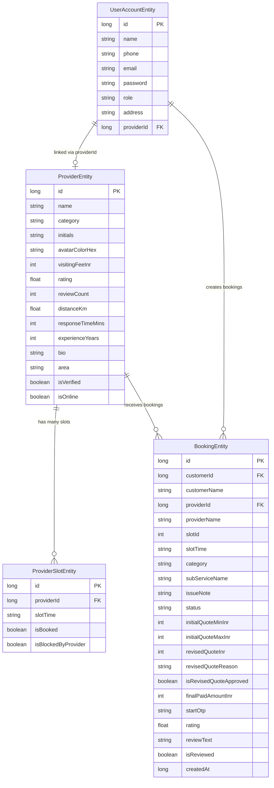

# Neighborly 

> **Local Skill & Service Marketplace** — A native Android MVP connecting nearby residents with verified skilled workers (electricians, plumbers, tutors, carpenters, appliance technicians, and more) across **Udaipur, Rajasthan**.

---

## Overview

**Neighborly** is an offline-first, mobile-first Android application built with **Kotlin**, **Jetpack Compose**, and **Room Database**. It provides a frictionless marketplace experience for both consumers seeking home services and local service professionals managing daily jobs, bookings, and earnings.

The app is architected around an offline local SQLite database with reactive `StateFlow` streams, requiring zero remote backend servers to run a fully functional end-to-end lifecycle—from user registration and slot booking to OTP job verification, quote revisions, payment settlement, and customer reviews.

---

## Key Features

### 1. Dual-Role Experience & Authentication
* **Role-Based Auth Flow:** Distinct sign-in and account creation paths for **Customers** and **Service Providers** backed by Room (`UserAccountEntity`).
* **Service Provider Onboarding:** Providers register their trade category, base visiting fee (₹), and years of experience, automatically provisioning their public profile and initial time slots.
* **Quick Demo Credentials:** Pre-configured test accounts for 1-tap test-filling:
  * **Customer:** `vikas@neighborly.in` | `password123`
  * **Provider:** `rajesh@neighborly.in` | `password123`
* **Account & Profile Management:** Edit personal details, address, trade specialization, and manage active sessions with safe logout.

### 2. Customer Journey
* **Live Discovery & Search:** Real-time search across 8 service categories with multi-attribute filtering:
  * **Categories:** Electrician, Plumber, Tutor, Carpenter, AC & Appliance Repair, Painter, Home Cleaning, Handyman.
  * **Quick Radius Filters:** `< 2 km` and `< 5 km`.
  * **Rating Filter:** `4.8+ Top Rated`.
* **Provider Profile & Transparent Pricing:**
  * Colored initials avatars with verified badges and real-time response time metrics.
  * Itemized transparent rate cards showing diagnostics/visiting fees and estimated ranges per sub-service.
* **Time Slot Booking:** Select 1-hour service slots with custom problem/issue notes.
* **Live Booking Tracker:** Real-time progression through lifecycle states:
  $$\text{Requested} \longrightarrow \text{Accepted} \longrightarrow \text{In Progress} \longrightarrow \text{Completed}$$
* **Start OTP Security:** Prominently generates a 4-digit security code upon provider acceptance to safeguard job commencement.
* **Quote Revision Approval:** If a provider encounters unforeseen parts or labor costs, customers can review the reason and approve revised estimates directly in-app.
* **Rating & Reviews:** Unlocks an interactive 5-star rating and written review dialog once jobs are marked completed.

### 3. Service Provider Journey
* **Provider Dashboard:**
  * Real-time **Online / Offline** availability toggle switch.
  * High-level metrics: Total Earnings (₹), Completed Jobs count, and Average Star Rating.
  * Active job cards with direct status badges and actions.
* **Reactive Slot Manager:**
  * Toggle daily 1-hour time slots between **Open for Booking** and **Blocked by You**.
  * Confirmed bookings are automatically locked to prevent schedule conflicts.
* **Incoming Job Requests:**
  * Review customer distance, requested sub-service, problem notes, and payout range with one-tap **Accept** or **Decline** (declined requests automatically release the slot).
* **Job Execution Flow:**
  * Verification gate requiring the customer's 4-digit **Start OTP** before initiating work.
  * **Revise Quote:** Add extra labor or replacement parts costs with customer-visible rationales.
  * **Mark Paid & Complete:** Finalizes the service invoice and transfers earnings into the provider log.
* **Work & Earnings History:**
  * Dedicated history ledger with total revenue calculations.
  * Filter by **All**, **Completed**, or **Cancelled / Declined**.
  * Itemized breakdown of base fee, approved parts/labor, and customer review feedback.

---

## Tech Stack & Architecture

Neighborly is built following modern Android Architecture Components and Google's recommended **Unidirectional Data Flow (UDF)** with **MVVM**.

| Layer | Technology | Description |
| :--- | :--- | :--- |
| **Language** | Kotlin 2.0.21 | 100% Kotlin with Coroutines & Flow |
| **UI Framework** | Jetpack Compose (BOM `2024.10.01`) | Declarative, reactive UI toolkit |
| **Design System** | Material 3 (`1.3.1`) | Clean theme, custom typography, 20dp cards, 0 emojis |
| **Icons** | Material Icons Extended | Native Material 3 vector iconography across all screens |
| **Navigation** | Jetpack Navigation Compose (`2.8.4`) | Single-activity Compose navigation graph |
| **Database** | Room (`2.6.1`) + KSP | Local SQLite database with reactive DAO `Flow`s |
| **Architecture** | MVVM + StateFlow | Reactive ViewModels managing explicit UI states |
| **App Icon** | Adaptive Icons (`anydpi-v26`) | Custom launcher mipmaps (`mdpi` to `xxxhdpi`) on `#13112B` |

---

## Design System & Theme

* **Primary Indigo (`#5B5FEF`):** Accent color, primary buttons, and active tabs.
* **Deep Navy (`#13112B`):** Headings, dark card backgrounds, and navigation emphasis.
* **Soft Lavender (`#F4F3FF`):** Neutral surface tints, pill backgrounds, and soft card fills.
* **Emerald Green (`#10B981`):** Success states, completed earnings, online badges.
* **Crimson Red (`#EF4444`):** Rejections, cancellations, and destructive actions.
* **Amber Star (`#F59E0B`):** Star ratings and in-progress job badges.
* **Zero Emojis:** All UI components, chips, status pills, and buttons use polished vector drawables (`Icons.Rounded.*`) for an authentic native look and feel.

---

## Database Architecture

The Room database (`neighborly_db`) manages 4 relational tables:



---

## Project Structure

```
app/src/main/
├── AndroidManifest.xml
├── java/com/neighborly/app/
│   ├── MainActivity.kt
│   ├── NeighborlyApplication.kt
│   ├── data/
│   │   ├── local/
│   │   │   ├── NeighborlyDatabase.kt
│   │   │   ├── dao/
│   │   │   │   ├── BookingDao.kt
│   │   │   │   ├── ProviderDao.kt
│   │   │   │   ├── SlotDao.kt
│   │   │   │   └── UserAccountDao.kt
│   │   │   └── entity/
│   │   │       ├── BookingEntity.kt
│   │   │       ├── ProviderEntity.kt
│   │   │       ├── ProviderSlotEntity.kt
│   │   │       └── UserAccountEntity.kt
│   │   └── seed/
│   │       └── DatabaseSeedData.kt          # 20+ Udaipur service providers & initial data
│   ├── model/
│   │   ├── BookingStatus.kt
│   │   └── ServiceCategory.kt               # 8 trade categories mapped to ImageVectors
│   ├── navigation/
│   │   └── NavGraph.kt                      # Central Jetpack Navigation controller
│   └── ui/
│       ├── auth/
│       │   ├── AuthScreen.kt
│       │   └── AuthViewModel.kt
│       ├── components/
│       │   ├── InitialsAvatar.kt
│       │   ├── ProviderCard.kt
│       │   ├── RatingDialog.kt
│       │   ├── StarRatingBar.kt
│       │   ├── StatusBadge.kt
│       │   └── TopBar.kt
│       ├── customer/
│       │   ├── BookingSlotScreen.kt
│       │   ├── CustomerDiscoveryScreen.kt
│       │   ├── CustomerViewModel.kt
│       │   ├── MyBookingsScreen.kt
│       │   └── ProviderDetailScreen.kt
│       ├── profile/
│       │   ├── ProfileScreen.kt
│       │   └── ProfileViewModel.kt
│       ├── provider/
│       │   ├── IncomingRequestsScreen.kt
│       │   ├── ProviderDashboardScreen.kt
│       │   ├── ProviderHistoryScreen.kt
│       │   ├── ProviderViewModel.kt
│       │   └── SlotManagerScreen.kt
│       └── theme/
│           ├── Color.kt
│           ├── Theme.kt
│           └── Type.kt
└── res/
    ├── mipmap-anydpi-v26/                   # Adaptive launcher icon XML definitions
    ├── mipmap-hdpi/ ... mipmap-xxxhdpi/     # Scaled launcher & round icons
    └── values/
        ├── colors.xml
        ├── strings.xml
        └── themes.xml
```

---

## Build & Installation

### Prerequisites
* **Android Studio:** Ladybug (2024.2.1) or newer
* **JDK:** Java 17 (recommended: Android Studio JBR 17)
* **Android SDK:** `compileSdk 35`, `minSdk 26`, `targetSdk 35`

### Building from Terminal

1. **Clone the repository:**
   ```bash
   git clone https://github.com/your-username/neighborly-android.git
   cd neighborly-android
   ```

2. **Assemble Debug APK:**
   * **Linux / macOS:**
     ```bash
     ./gradlew assembleDebug
     ```
   * **Windows (PowerShell / Command Prompt):**
     ```powershell
     .\gradlew.bat assembleDebug
     ```

3. **Install on Connected Device or Emulator:**
   ```bash
   adb install -r app/build/outputs/apk/debug/app-debug.apk
   ```

---

## Testing & Seed Data

On first launch, the local Room database automatically pre-populates:
* **22 Verified Providers** across all 8 trades in Udaipur localities (Hiran Magri, Panchwati, Fatehpura, Sukher, City Station Road, etc.).
* **Daily 1-Hour Time Slots** (9:00 AM – 6:00 PM) for each provider.
* **Pre-Seeded Booking History** for the default provider account (`rajesh@neighborly.in`), demonstrating completed jobs with earnings, ratings, and cancellations.

To test both customer and provider perspectives:
1. Log in with **Customer** credentials (`vikas@neighborly.in`), browse providers, and submit a booking request.
2. Log out from the **Profile** tab.
3. Sign in as **Provider** (`rajesh@neighborly.in`), accept the request on the dashboard, input the customer's Start OTP, adjust quotes if needed, and complete the order.
4. Sign back into the Customer account to approve revised quotes and leave a 5-star review.
